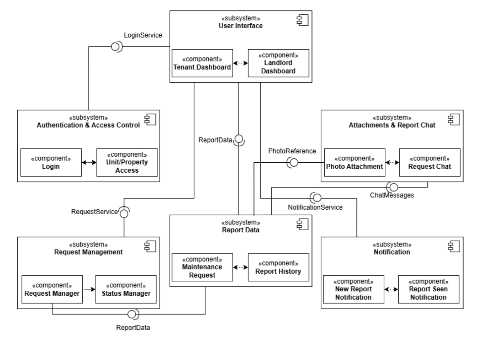
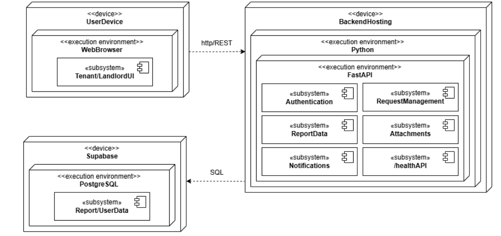

# 1530_Maintenance_Tracker
Members: Yifei Tian, Bakhtiyor Alimov, Dylan Do, Edward Cho, Akshay Ramkumar

## Project Description
* Maintenance Tracker is a web application that helps tenants and landlords manage apartment maintenance issues in one shared place. Today, many maintenance problems go unreported because each roommate assumes someone else already told the landlord, and the ones that do get reported are scattered across text messages with no clear record of who reported what, when, or what happened next.

* With Maintenance Tracker, a tenant logs into an account linked to their unit and submits a report with a short description and an optional photo. Every tenant in the unit can see all active reports, which prevents duplicate messages and makes sure everyone knows an issue has already been raised. Each report is dated on submission and carries a status, so tenants can follow its progress. The landlord can review incoming reports, update their status as action is taken, and mark them resolved.

## Tech Stack

| Layer | Technology | Justification |
|---|---|---|
| Language(s) | Python, JavaScript | Python will be used for backend functionality while JavaScript will be used for the UI |
| Frontend | Next.js, React | Next.js allows us to create reusable components which will be nice if we want to make a different dashboard for tenants and landlords |
| Backend | Python | Our team has most experience using python.|
| Database | PostgreSQL, Supabase | We want to host our database so our team can access and see data without having to configure a separate database. |
| APIs / External Service | FastAPI | FastAPI will allow us to practice making endpoints and will be easy to divide up services for team members. |


## Architecture

### Subsystem Decomposition


### Deployment Diagram


### Folder Structure

| Folder | Subsystem | Component | Status |
|---|---|---|---|
| `frontend/` | User Interface | Tenant Dashboard, Landlord Dashboard | Placeholder |
| `backend/app/auth/` | Authentication & Access Control | Login, Unit/Property Access | Placeholder |
| `backend/app/requests/` | Request Management | Request Manager, Status Manager | Placeholder |
| `backend/app/reports/` | Report Data | Maintenance Request, Report History | Placeholder |
| `backend/app/notifications/` | Notification | New Report Notification, Report Seen Notification | Placeholder |
| `backend/app/attachments/` | Attachments & Report Chat | Photo Attachment, Request Chat | Placeholder |
| `docs/` | N/A | Subsystem-decomposition, deployment-diagram images | N/A |


## Prerequisites

* Python 3.12 or higher
* Node.js
* npm
* Access to the team's Supabase project
* Git

## Setup and Run

### 1. Clone

```bash
git clone https://github.com/YifeiTi/1530-Maintenance_Tracker.git
cd 1530-Maintenance_Tracker
```
### 2. Environment Variables

The backend does not connect to the database yet, so no `.env` values are required to run the skeleton. Database credentials will be added in Sprint 5.

### 3. Backend

```bash
cd backend
python3 -m venv venv
source venv/bin/activate      # Windows: venv\Scripts\activate
pip install -r requirements.txt
uvicorn app.main:app --reload
```

### 4. Frontend


## How to Check That It Works

* Backend
  * Open http://localhost:8000/health in your browser. `{"status":"ok"}`
* Frontend
* Database
  * The Supabase project (Maintenance-Tracker) contains the schema tables: properties, units, profiles, maintenance_requests, request_attachments, request_messages. Backend connection is planned for Sprint 5.
 
## What Works So Far
* FastAPI backend starts and the `/health` endpoint responds.
* Supabase project is set up with the initial database schema.

## What Does Not Work Yet
* Backend-to-database connection, login, report submission, and notifications (planned for Sprint 5).


