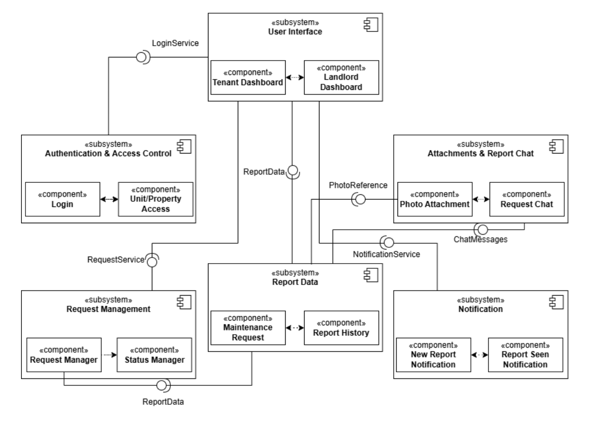
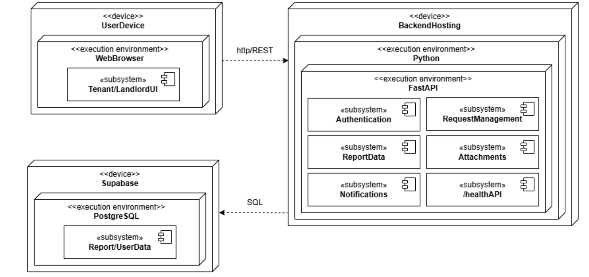

# 1530_Maintenance_Tracker

Members: Yifei Tian, Bakhtiyor Alimov, Dylan Do, Edward Cho, Akshay Ramkumar

## Project Description

- Maintenance Tracker is a web application that helps tenants and landlords manage apartment maintenance issues in one shared place. Today, many maintenance problems go unreported because each roommate assumes someone else already told the landlord, and the ones that do get reported are scattered across text messages with no clear record of who reported what, when, or what happened next.

- With Maintenance Tracker, a tenant logs into an account linked to their unit and submits a report with a short description and an optional photo. Every tenant in the unit can see all active reports, which prevents duplicate messages and makes sure everyone knows an issue has already been raised. Each report is dated on submission and carries a status, so tenants can follow its progress. The landlord can review incoming reports, update their status as action is taken, and mark them resolved.

## Tech Stack

| Layer                   | Technology           | Justification                                                                                                                         |
| ----------------------- | -------------------- | ------------------------------------------------------------------------------------------------------------------------------------- |
| Language(s)             | Python, JavaScript   | Python will be used for backend functionality while JavaScript will be used for the UI                                                |
| Frontend                | Next.js, React       | Next.js allows us to create reusable components which will be nice if we want to make a different dashboard for tenants and landlords |
| Backend                 | Python               | Our team has most experience using python.                                                                                            |
| Database                | PostgreSQL, Supabase | We want to host our database so our team can access and see data without having to configure a separate database.                     |
| APIs / External Service | FastAPI              | FastAPI will allow us to practice making endpoints and will be easy to divide up services for team members.                           |

## Architecture

### Subsystem Decomposition



### Deployment Diagram



### Folder Structure

| Folder                       | Subsystem                       | Component                                          | Status      |
| ---------------------------- | ------------------------------- | -------------------------------------------------- | ----------- |
| `frontend/`                  | User Interface                  | Tenant Dashboard, Landlord Dashboard               | Running     |
| `backend/app/auth/`          | Authentication & Access Control | Login, Unit/Property Access                        | Placeholder |
| `backend/app/requests/`      | Request Management              | Request Manager, Status Manager                    | In progress |
| `backend/app/reports/`       | Report Data                     | Maintenance Request, Report History                | In progress |
| `backend/app/notifications/` | Notification                    | New Report Notification, Report Seen Notification  | Placeholder |
| `backend/app/attachments/`   | Attachments & Report Chat       | Photo Attachment, Request Chat                     | Placeholder |
| `docs/`                      | N/A                             | Subsystem-decomposition, deployment-diagram images | N/A         |

`backend/app/main.py` is the FastAPI entry point. Report endpoints are in `backend/app/requests/routes.py`, and database queries are in `backend/app/reports/store.py`. The other subsystem folders are still placeholders.

## Prerequisites

- Python 3.12.4 (tested)
- Node.js v26.10.0 (tested)
- npm 11.19.1 (tested)
- Access to the team's Supabase project
- Git

## Setup and Run

### 1. Clone

```bash
git clone https://github.com/YifeiTi/1530-Maintenance_Tracker.git
cd 1530-Maintenance_Tracker
```

### 2. Environment Variables

The backend connects to the team's Supabase PostgreSQL database through the DATABASE_URL environment variable. Copy backend/.env.example to backend/.env and replace [YOUR-PASSWORD] with the database password (ask a teammate, or reset it in Supabase under Project Settings, Database). Never commit .env; it is gitignored.

If the direct connection fails on your network (IPv6 only), use the Session pooler connection string instead (Supabase: Connect > Session pooler).

### 3. Backend

```bash
cd backend
python3 -m venv venv
source venv/bin/activate      # Windows: venv\Scripts\activate
pip install -r requirements.txt
uvicorn app.main:app --reload
```

### 4. Frontend

```bash
cd frontend
npm ci
npm run dev
```

The frontend forwards `/api/reports` requests to FastAPI at `http://127.0.0.1:8000`. Start the backend and frontend in separate terminals. If the backend runs elsewhere, set `API_BASE_URL` before starting/building Next.js (for example, `API_BASE_URL=http://127.0.0.1:8001 npm run dev`). Do not place database credentials in this variable.

## How to Check That It Works

- Backend
  - Open http://localhost:8000/health in your browser. `{"status":"ok"}`
- Frontend
  - Open http://localhost:3000 in your browser. You should see the main page of Maintenance Tracker.
- Database
  - The Supabase project (Maintenance-Tracker) contains the schema tables: properties, units, profiles, maintenance_requests, request_attachments, request_messages. The backend reads DATABASE_URL from backend/.env; with the backend running, open http://localhost:8000/health/db and you should see {"status":"ok"} if the Supabase connection works (otherwise status is "error" with the exception name).

### Tests

```bash
cd backend
pytest
```

## Features

### Report screens

At http://localhost:3000, enter an existing test unit UUID and tenant UUID. Select **Load active reports** to list that unit’s active issues. Enter a title and description and select **Submit report**; after a successful API response, the form clears and the active list refreshes. Open a list item to read its latest status, submission date, and planned fix. Blank fields are rejected and failed requests show an error; a failed submission keeps the entered text.

The database uses `open`, `in_progress`, and `resolved`. The UI displays these as Submitted, In progress, and Resolved without changing API/database values. The list endpoint does not return a title, so the list uses the description as its link label.

**Current limit:** manually entered UUIDs are test context, not login. The backend does not yet enforce unit membership, and the landlord role header remains a placeholder. Do not use this prototype with private tenant data. These stories remain partial until US1 is implemented. Chat, attachments, notifications, and status-history preservation are not added by this PR.

### Submit a maintenance report

Send `POST /reports` with `title`, `description`, `unit_id`, and `tenant_id`. Use UUIDs for both IDs. Blank titles and descriptions are rejected. A saved report starts with status `open`, and its `submitted_at` response field comes from the database's `created_at`. With the backend running, try it at http://localhost:8000/docs.

### View active reports
Send `GET /reports?unit_id=<unit uuid>` to get every active report for a unit (any status except resolved), newest first. Try it at http://localhost:8000/docs under `GET /reports`.

### Update a report as a landlord

Run this once in the Supabase SQL Editor before using `PATCH /reports/{report_id}`.

```sql
ALTER TABLE maintenance_requests ADD COLUMN IF NOT EXISTS planned_fix_note text;
```

Send `X-User-Role: landlord` and a JSON body such as `{"status": "in_progress", "planned_fix_note": "Plumber coming Monday"}`. The allowed status updates are `in_progress` and `resolved`. You can send either field on its own. Leaving the note out or sending `null` keeps the existing note. The response includes the updated report and its new `updated_at` timestamp.

The endpoint returns `403` for other roles or a missing role header, `422` for an invalid status or an empty update, and `404` if the report ID does not exist. The role header is a placeholder until login is implemented.

## What Works So Far

- FastAPI backend starts and the `/health` endpoint responds.
- `POST /reports` creates an open maintenance report.
- `GET /reports` returns a unit's active reports.
- Next.js frontend submits reports, loads active reports, and opens report details through the existing backend APIs.
- Supabase project is set up with the initial database schema.
- Backend connects to Supabase through the session pooler (/health/db).

## What Does Not Work Yet

- Login and server-enforced unit/property access, notifications, request chat, attachments, and complete status-history preservation.
- Landlord updates are available through the API; there is no landlord update form yet.

## Frontend verification

```bash
cd frontend
npm test
npm run build
```

The frontend tests check status labels, submission timestamps, and API error messages. CI runs them before the frontend build. See `docs/sprint5-frontend-verification.md` for the proxy integration check and its limits.


## GenAI Usage

Generative AI was used by some team members this sprint for coding, debugging, and writing tests. The tool, purpose, and prompts or transcript for each person are listed below.

| Team member | Tool and purpose | Prompts, transcript, or affected files |
| --- | --- | --- |
| Bakhtiyor Alimov | Cursor, to draft POST /reports and the blank-description test. | Write a FastAPI POST /reports endpoint. The body has description and unit_id. Reject a blank description with 400 and the message "Description is required." Insert into maintenance_requests with status Submitted and a server-set submitted_at, and return the new row. Add one pytest that posts a blank description and expects 400, without needing a database connection. |
| Yifei Tian | ChatGPT was used for coding, debugging, and making a good prompt for Codex for issues that needed resolving. | Codex made a patch endpoint so landlords are able to modify entries of reports' statuses. It also helped debug the Supabase connection and test to see if the connection was working. Transcript: https://chatgpt.com/share/6b0116ea-3ae0-83ea-b5ae-83d4c4524022 |
| Akshay Ramkumar | Frontend tests and web layout. | Prompts not yet listed. |
| Edward Cho | Assistance with writing tests for GET /reports only. | To get help create a pytest test for the GET /reports endpoint. |

The prompts above are as originally written. Some were written before POST /reports was fixed to match the Supabase schema, so they mention the old status "Submitted" and a submitted_at column. The database now uses the statuses open, in_progress, and resolved, and the timestamp column is created_at.
